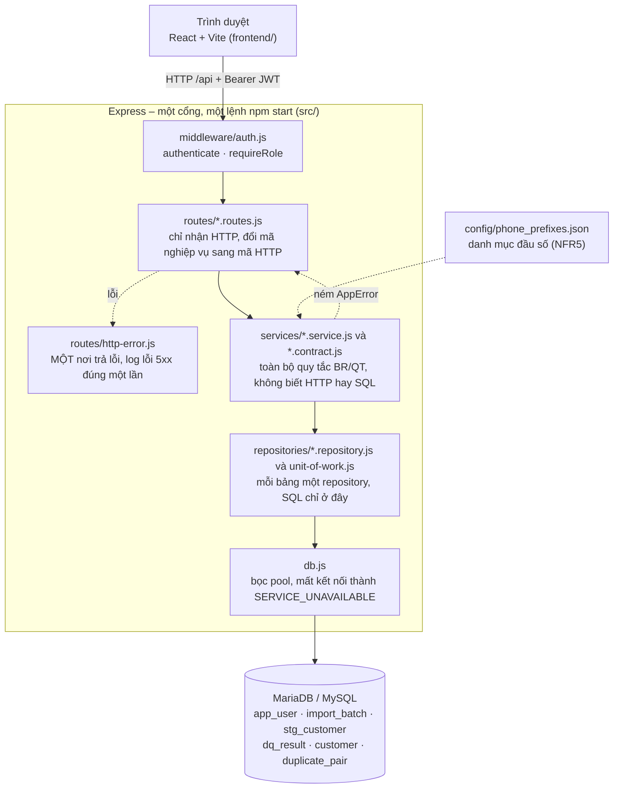

# Kiến trúc thực tế đã hiện thực

Sơ đồ dưới đây vẽ **mã đang chạy** ở tag `v0.2`, không phải thiết kế ban đầu. So với `docs/architecture.drawio` của Bài tập 1, những chỗ khác nhau nằm ở mục 5.

## 1. Sơ đồ



## 2. Các lớp và ranh giới

| Lớp | Thư mục | Làm gì | Không được làm | File tiêu biểu |
| :--- | :--- | :--- | :--- | :--- |
| Giao diện | `frontend/src/` | Hiện màn hình, ba trạng thái (đang tải, rỗng, lỗi) qua `DataState` | Gọi `fetch` ngoài `api/client.js` | `api/client.js`, `components/DataState.jsx` |
| API | `src/routes/`, `src/middleware/` | Nhận HTTP, kiểm vai trò, gọi service, trả JSON | Chứa nghiệp vụ hoặc SQL | `customer.routes.js`, `auth.js` |
| Nghiệp vụ | `src/services/` | Mọi quy tắc BR/QT, kiểm dữ liệu vào, hợp đồng dữ liệu `*.contract.js` | Biết HTTP (`req`, `res`, mã trạng thái) hoặc SQL | `customer.service.js`, `import.service.js`, `user.service.js` |
| Truy cập dữ liệu | `src/repositories/` | Câu SQL, đổi lỗi khóa của CSDL sang `ConstraintError`, gom thao tác ghi vào một giao dịch (`unit-of-work.js`) | Chứa nghiệp vụ | `customer.repository.js`, `unit-of-work.js` |
| Hạ tầng | `src/db.js`, `src/logger.js`, `src/errors/` | Kết nối CSDL, ghi log JSON có `requestId`, lớp lỗi `AppError` | | `db.js`, `AppError.js` |

Lỗi đi theo một đường: repository đổi lỗi thư viện (không log) → service ném `AppError` có mã nghiệp vụ → `routes/http-error.js` đổi sang mã HTTP và log đúng một lần kèm `requestId`.
Riêng mất kết nối CSDL thì `db.js` đổi thành `SERVICE_UNAVAILABLE` (503) ngay ở lớp dưới cùng.

## 3. Ba luồng tiêu biểu

**Nhập file (NFR3: một giao dịch).** `POST /api/imports` → `import.routes.js` (multer, tối đa 5 MB) → `ImportService.importFile` đọc UTF-8 nghiêm ngặt và kiểm từng dòng bằng `RecordValidator` (chưa chạm CSDL) →
`UnitOfWork.run`: tạo lần nhập, tra SĐT, khôi phục hồ sơ đã xóa mềm, thêm hồ sơ mới, ghi bản ghi nhập và lỗi, tìm cặp nghi trùng → `COMMIT`, hoặc `ROLLBACK` toàn bộ nếu bất kỳ bước nào lỗi → 201.

**CSDL tắt.** Mọi truy vấn đi qua pool đã bọc ở `db.js` → `ECONNREFUSED` thành `AppError('SERVICE_UNAVAILABLE')` → `http-error.js` trả 503 kèm `requestId` → `client.js` → `DataState` hiện thông báo ba phần và nút Thử lại.

**Xóa mềm hồ sơ.** `DELETE /api/customers/{code}` → `requireRole('DATA_STAFF')` → `CustomerService.remove` → `UnitOfWork.run`: khóa dòng (`FOR UPDATE`), kiểm ba luật chặn (đã gộp, là hồ sơ giữ lại, đang trong cặp chờ duyệt), `softDelete` → 204.

## 4. Kiểm ranh giới lớp (lệnh và kết quả)

```bash
rg -n -e '\breq\b' -e '\bres\b' -e 'status\(' -e 'express' -e '\bSELECT\b' -e '\bINSERT\b' -e '\bUPDATE\b' -e 'DELETE FROM' src/services   # (rỗng)
rg -n "require\('\.\./(routes|middleware|repositories)" src/services                                                                      # (rỗng)
rg -n "require\('\.\./(services|routes|middleware)" src/repositories                                                                      # (rỗng)
rg -n -e "require\('\.\./repositories" -e '\bSELECT\b' -e 'pool' src/routes                                                                # (rỗng)
```

Ngoại lệ duy nhất em biết: `GET /health` trong `src/app.js` chạy `SELECT 1` để biết CSDL còn sống; nó không đi qua repository vì không thuộc bảng nào.

## 5. Khác với sơ đồ Bài tập 1

| Thành phần ở BT1 | Hiện trạng | Ghi chú |
| :--- | :--- | :--- |
| ImportController, DuplicatePairController, Customer Controller, Xác thực | `import.routes.js`, `duplicate-pair.routes.js`, `customer.routes.js`, `auth.routes.js` + `middleware/auth.js` | Khớp thiết kế |
| ImportService, DuplicateService, RecordValidator | `src/services/` | Khớp |
| 6 Repository (ImportBatch, StgCustomer, DqResult, Customer, DuplicatePair, AppUser) | `src/repositories/` | Khớp; thêm `unit-of-work.js` cho NFR3 |
| RecordController (sửa bản ghi lỗi, E8), Report Controller và ReportService (E10) | `record.routes.js`, `report.routes.js`, `report.service.js` còn là khung rỗng | **Chưa làm**, đã ghi ở `docs/thay-doi-thiet-ke.md` mục 9 |
| (không có) | `src/db.js`, `src/routes/http-error.js`, `src/logger.js`, `user.routes.js`, `user.service.js` | **Thêm ở Bài tập 2**: `docs/thay-doi-thiet-ke.md` mục 17 đến 20 |

## 6. Cây thư mục chính

```text
src/
  app.js, server.js, db.js, logger.js
  errors/        AppError.js
  middleware/    auth.js
  routes/        auth, customer, import, duplicate-pair, user, http-error (record, report: khung rỗng)
  services/      auth, customer, import, duplicate, user, record-validator, similarity, access-scope, paging, *.contract.js
  repositories/  app-user, customer, import-batch, stg-customer, dq-result, duplicate-pair, unit-of-work, batching
frontend/src/    api/ (client, *.api.js, messages), components/ (DataState, Layout), pages/ (Login, Import, Errors, Pairs, PairDetail)
migrations/      001_init.sql, 002_customer_soft_delete.sql      seeds/ 001_demo.sql      config/ phone_prefixes.json
scripts/         env:init, db:setup, run-sql (migrate, seed), gen-sample-csv, count-rows, e2e
tests/           node --test, repository giả trong tests/helpers/
```
